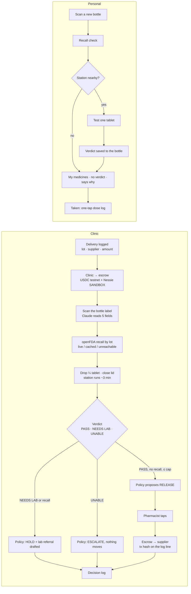

# Pill app plan (Sat 2026-10-24, draft 2 after Preston's notes at 01:4x)

One web app, three places: the phone (any browser), the Pi touchscreen on the station (Chromium kiosk), and a laptop at the judges' table. Same backend (FastAPI, SOFTWARE-PLAN §4), same seven rules, same words as the website. Code: `~/calhacks-13/pill/web` (Vite + React + TS), dev server http://127.0.0.1:5183.

## 0. Preston's direction (01:4x), applied
- **Quality bar:** Linear and the Tesla app. **Light mode** (not dark). Simple, good animations. Very informative, and simple enough for grandparents; medical mode may carry more.
- **The hero idea:** while the station streams, the app fills a drawing of a pill with colour from 0 % to 100 %; at 100 % it gives an overall evaluation, and the evaluation has to be really good (verdict, % of reference, the two numbers, what the drug is used for, next step, ship yes/hold/ask in medical mode).
- **Onboarding:** first screen asks who you are: hospital / medical center / enterprise, or personal. Personal → reminders, bigger text, fewer words. Medical → a list: per lot, good/bad as the verdict word, a percentage (% of reference plateau), what it's used for, good for shipment yes / hold / ask.
- **Dashboard** only where a list is needed (deliveries, log); no dashboard home.
- **AI chat** slot ("Ask Pill") in the app now, marked not connected; Preston wires the service later.
- Honesty rules stay: verdict words PASS / NEEDS LAB / UNABLE TO VERIFY, "ship: yes" is the clinic's release word, percentage = plateau as a share of the reference mean (a real number), money SANDBOX / TESTNET, no banned words.
- Decisions 1–5 from draft 1 are resolved by the above: one app with onboarding, light, hand-drawn SVG (pill + curve), x402 screen in the app, photo by file input.

## 0b. Traction (Research, 01:5x; full note with links: `~/boss-handoff/agents/research/calhacks-app-traction-2026-10-24.md`)
- Plays that fit Pill: (a) a hackathon placing → the school press office on Sunday (Peel got RIT newsroom + The Tech coverage this way); (b) a 20–30 s demo clip on X/LinkedIn/TikTok (Theseus' hackathon demo tweet → YC a day later → $4.3M); (c) Show HN only once people can try something (HN rejects sign-up pages); Product Hunt goes live 12:01 AM PT; (d) an NGO pilot ask: 20 B2 tablets side by side with a Minilab (BU's PharmaChk went Ghana field test → $2M grant → Merck). Referral waitlists are the weakest fit.
- Claims: FDA "device" = intended for diagnosis/treatment, so no patient-outcome claims; FTC wants competent and reliable scientific evidence for health claims, apps included. Say "screens dissolution against a reference; prototype". Never "detects counterfeits", "verified safe", "lab-grade".
- Channels for pharmacists/NGO clinics: FIP (159 member orgs), pharmacist WhatsApp groups via their leaders, the Difäm-EPN Minilab Network (16 orgs, 13 countries).
- First-1,000 lessons: Oura (Kickstarter), Whoop (athletes via coaches; fame didn't sell), Flighty (a tweet, then an 18-month beta with frequent flyers and pilots), Medisafe (channel unsourced).

## 1. The whole process

Rules that never change on any screen: three verdicts only; "why" is two sentences, filtered; money says SANDBOX / TESTNET; `LIVE SENSOR` / `REPLAY` / `SIMULATED` badge in the corner of every run; red only for a recall hit or a held payment, never for a verdict.

## 2. Screens (12). Build in this order; each one has its empty, loading and fault state before its happy state.

| # | Screen | What is on it | Real data comes from | Site mock state |
|---|---|---|---|---|
| 1 | **Home** | Clinic / Personal switch (huge), station status chip (`STATION 01 · online · calibrated 03:12`), one button: Start scan. Personal: My medicines shortcut. | `GET /station`, localStorage mode | — |
| 2 | **Bottle** | Camera viewfinder with corner marks; after the shot: 5 fields typing in (drug, strength, lot, maker, expiry), each editable; recall chip: `no openFDA record` / `RECALL <number>` (red) / `lookup unavailable · cache <date>`. Photo deleted after extraction (say so). | `POST /bottle` (Claude vision) → `GET /recall?lot=` | `bottle`, `recall` |
| 3 | **Place the tablet** | Three-line checklist with the four station checks lighting up live: LED baseline, dark reading, paddle, lid. "Drop one quarter tablet. Close the lid." Start enables when all four are green. | SSE `/stream` fields `led, dark, paddle, lid` | `scan` (checks row) |
| 4 | **Run** | Progress bar "dissolving… 62 % of expected plateau", live A(t) curve over the dotted reference band, the green 90° glow line, temp, elapsed, scatter sparkline. Fault: bar freezes grey, fault named in words ("lid opened at 0:41"). | SSE `/stream` | `scan` |
| 5 | **Verdict** | Full-screen card: PASS (mint) / NEEDS LAB (amber, warm-red glow only if a payment is held) / UNABLE TO VERIFY (grey). The two numbers that decided it + rule id, the filtered two-sentence why, Save / Next. | `GET /runs/{id}` | `pass`, `needslab`, `unable` |
| 6 | **Delivery** (clinic) | Lot, supplier, `$1,240.00 held · SANDBOX`, USDC `TESTNET` balance line, the spend cap, policy outcome (release / hold / escalate) with the clause quoted, and the buttons: **Release** (only when outcome = release), Hold, Escalate. Release = the pharmacist tap. | `GET /deliveries/{id}`, `POST …/approve` | `delivery`, `released` |
| 7 | **Decision log** | One row per decision: time, lot, verdict, rule, clause, outcome, tx hash / nessie id, who tapped. Filter by lot. Export CSV. | `GET /log` | — |
| 8 | **My medicines** (personal) | One card per bottle: drug, lot, verdict of its tested tablet (or "not tested, no station"), recall status + date checked, Taken button with the last timestamp. Banner: "Measuring a dose needs the station; this list does not re-test." | `GET /bottles` | `medicines` |
| 9 | **Calibration** | Ten reference curves settling into the band, `runs 7/10`, CV %, leave-one-out ✓/✗, Save reference (disabled until CV ≤ 15 %). Also shown on the Pi while the team calibrates tonight. | `POST /calibrate`, SSE | `calibration` |
| 10 | **Report** | The PDF content as a page: curve, numbers, verdict, log line, QR to the run. Download / Share. | `GET /runs/{id}/report.pdf` | — |
| 11 | **Pay for a verdict** (x402) | For the track demo: paste or upload a curve → `402` shown → Pay (testnet wallet) → `200` verdict. A terminal-style log like the site. | `POST /verify` with x402 | site `x402` widget |
| 12 | **Pi kiosk** | Screens 3–5 only, landscape, 7-inch, buttons ≥ 64 px, auto-returns to "Place the tablet" after 60 s. No camera (the phone does the label). | same SSE | — |

## 3. Design direction (decided by the site; apply, don't re-debate)
- Dark instrument UI: ink `#0E1216` background, text `#E9EEF2`, mono for every number, sans for sentences, serif only on the verdict word. Sky `#4FB3FF` for the live curve and lines, mint `#5FD39A` for the glow line and PASS, amber `#D4652E` for NEEDS LAB, grey for UNABLE, warm red `#E0532E` only for recall / held. Coinbase blue `#0052FF` only on the payment lines.
- One action per screen, the button is the bottom 15 % of the phone, ≥ 56 px tall. The Pi gets 64 px.
- Numbers first, words second: plateau, band, scatter, temp, elapsed are always visible on Run and Verdict.
- Every screen names what it is not doing: "not a pharmacopeial test", "SANDBOX", "photo deleted", "no station nearby".
- Motion: curves draw, numbers count, the verdict card rises; nothing bounces. `prefers-reduced-motion` = static.

## 4. Inspiration (opened in Safari for Preston, 01:2x; pick 3 to copy from, the rest is noise)
| App | Steal this | Link |
|---|---|---|
| **Oura** | Readings page: one big number, a sparkline, a sentence; "contributors" rows | https://ouraring.com/oura-experience |
| **Whoop** | Recovery score as a full-screen colour state; the "why" under it | https://www.whoop.com/us/en/the-whoop-experience/ |
| **Flighty** | Live timeline with a progress bar and a running status line; honest delay reasons | https://flighty.com |
| **Mercury** | Money pages that feel calm: balances in mono, an approval flow with a clear "who approves" | https://mercury.com |
| **Coinbase app** | Transaction rows with status chips and tx hash; the blue accent on lines | https://www.coinbase.com/mobile |
| **Medisafe** | Medication list and the "Taken" tap; reminders done right, no nagging | https://www.medisafe.com |
| **Halide** | Viewfinder with technical readouts in the corners; camera UI that respects the photo | https://halide.cam |
| **Copilot Money** | Rules / decision log layout, categorised rows, one line per event | https://copilot.money |
| **Tesla app** | Device status page: product image at top, status chips, big actions | https://www.tesla.com/support/tesla-app |
| **Eight Sleep** | Device + sensor readings + temperature as the hero number | https://www.eightsleep.com/app/ |
| **Linear mobile** | Dark, dense, mono labels; list rows with status dots | https://linear.app/mobile |
| **Carrot Weather** | Personality in the status line without lying; still shows the numbers | https://www.meetcarrot.com/weather/ |
| **Gentler Streak** | Calm health UI, no red shaming, soft colour states | https://gentlerstreak.com |
| **Robinhood** | The line chart with a scrubber; press-and-hold to read a value | https://www.robinhood.com/us/en/ |
| **Things 3** | Checklists that feel finished; the "Place the tablet" screen wants this | https://culturedcode.com/things/ |

Shortlist I'd pick: **Oura** (Verdict + Run numbers), **Flighty** (Run progress + status line), **Mercury** (Delivery approval + decision log). Coinbase for the payment rows only.

## 4c. Design references (Preston, Sat 12:5x; ideas and checks only, never copy a design or its assets)
- details.so: curated real-site hero sections, footers, preloaders, page transitions, animations.
- refero.design: searchable library of real web + iOS UI screens (search "assistant", "chat", "bottom sheet", "voice input" for the follower).
- designspells.com: small delightful UI details and micro-interactions (launchers, typing indicators, send/stop morphs).
Use for the Gemini chat + bottom-right follower first, then every review pass.

## 5. Stack and layout
- `pill/web/`: Vite + React 19 + TypeScript, Recharts for the curve (or a 60-line SVG; Recharts is fine), `EventSource` for `/stream`, Zustand for mode/run state, CSS variables from the site tokens (copy `pill-site/src/styles.css` `:root`). PWA manifest so it installs on the phone; served by FastAPI `StaticFiles`.
- Screens are routes: `/`, `/bottle`, `/place`, `/run/:id`, `/verdict/:id`, `/delivery/:id`, `/log`, `/medicines`, `/calibrate`, `/report/:id`, `/verify`, `/kiosk`.
- Mock-first: `src/mock/` replays `runs/B2-07.csv` and `runs/TM-02.csv` through the same `EventSource` interface so every screen works before the box does (SOFTWARE-PLAN §10). The `src` badge comes from the stream, never hard-coded.
- Camera: `<input type="file" accept="image/*" capture="environment">` (works in Safari on iPhone; no WebRTC fuss). Photo → `POST /bottle` → deleted server-side after extraction.
- No login. Clinic mode is a switch, not an account; the pharmacist tap is a named button press logged with a device id.

## 6. Build order (2 devs, from Sat 02:00; the box is being calibrated in parallel)
| When | Dev B (web) | Dev A (firmware/backend) |
|---|---|---|
| 02:00–03:00 | Vite scaffold, tokens, routes, mock stream, Home + Place + Run with replay | ESP32 JSON stream, `logger.py`, calibration runs |
| 03:00–04:00 | Verdict card (3 states), Bottle (file input + fields form) | `/stream`, `/runs`, rules U1–P1, band from tonight's CSV |
| 04:00–05:00 | Delivery + Decision log, My medicines | Claude "why" + filter, openFDA with cache, policy.py |
| 05:00–06:00 | Calibration screen, Pi kiosk route, report page | CDP wallets + Nessie mirror, `/verify` with x402 (testnet) |
| 06:00–07:00 | Polish: motion, empty states, phone QA on real iPhone | end-to-end: real run → verdict → tap → tx hash on the log |
| 07:00–08:00 | Freeze. Screenshots for Devpost + site "real results" section | replay files for the judges' table |
Sleep is in there somewhere; the hour-by-hour in PLAN.md still rules.

## 7. Decisions for Preston (answer with the number)
1. **Mode UI:** one app with a switch (recommended) · or two separate apps/URLs.
2. **Look:** dark instrument UI like the site's phone mock (recommended) · or light paper UI matching the website body.
3. **Chart:** Recharts (fast to build) · or hand-drawn SVG like the site (prettier, more work).
4. **x402 screen:** build screen 11 in the app (recommended for the Coinbase track) · or only the terminal demo on the site.
5. **Camera:** file-input photo (works everywhere, recommended) · or live viewfinder with WebRTC (cooler, Safari risk).
