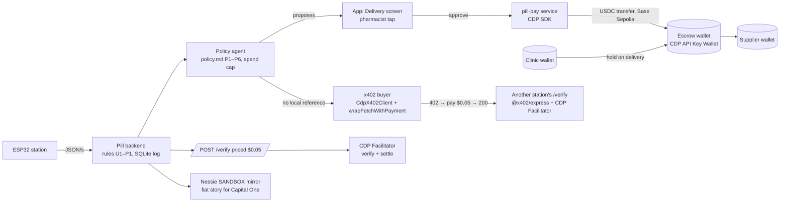

# Coinbase track: how Pill wins "Payment Agents" (Sat 2026-10-24, 02:0x PDT)

Source read tonight: the Coinbase brief PDF linked from the Hive prizes page (saved at `research/coinbase-x402-track.pdf`), docs.cdp.coinbase.com (x402 welcome, seller + buyer quickstarts, agents overview). Prize line on Hive: "Best Use of x402 by Coinbase · $500 USDC + recruiter call per team member per track, for each of the two tracks (up to $4000 total)". One winning team per track.

## 1. What the brief actually asks (verbatim where it matters)
- Two tracks. **Payment Agents**: "Give an agent a way to pay for things, earn money, or both. Use the Coinbase MCP for Agents and x402." Examples: "an agent that buys tools to finish a job; sells research or a service; hires another agent; or manages the budget for a small business." **Trading Agents** is not us.
- "You don't need to build a standalone app." Skills, templates, integrations and starter kits are eligible.
- Judging: **Usefulness** (clear problem, identifiable user) · **Technical design** (works reliably; explain models, tools, memory, scheduling) · **Ease of reuse** (another person can install it and complete the core task from your instructions) · **Product feedback** (insightful, actionable feedback on building with Coinbase for Agents).
- "We won't score projects on code volume, trading returns, or money spent. Real-money transactions are not required. Label simulated actions clearly, keep credentials private, and don't manage funds for other people."
- Submit: **project summary** (who it's for, what it does, which agent platform + Coinbase tools), **working example** (short demo + repo / installable skill / hosted link with setup), **architecture** (components, controls, known limitations), **builder feedback** (biggest blocker, workaround, the one missing Coinbase capability you most want).
- Getting started: create a Coinbase account (eligibility), API key at portal.cdp.coinbase.com.
- Eligibility per member: 18+, legal resident of the US or Canada (not Quebec), a verified Coinbase account in that person's own name; affidavit may be required. Check who on the team qualifies before the pitch leans on the prize; the project can still enter regardless.

## 2. Our angle in one paragraph (this is the project summary)
Pill's **policy agent is a payment agent for a clinic's pharmacy**. It holds a supplier's payment in escrow when a delivery is logged, reads the station's verdict on one tablet (PASS / NEEDS LAB / UNABLE TO VERIFY), checks the lot against openFDA, applies a six-clause plain-text policy, and proposes release / hold / escalate. It **pays**: when it proposes release and the pharmacist taps, it moves USDC from the escrow wallet to the supplier on Base (testnet, labelled); when a lot has no local reference, it **buys a verdict** from another Pill station over x402 for $0.05, under a $1 spend cap. It **earns**: every station sells verdicts over x402 (`POST /verify`), so a clinic that calibrated a drug last night can sell that reference to the clinic next door. Users: the clinic pharmacist and the pharmacy tech. Platform: our own agent loop (FastAPI/Node) with Claude writing only the two-sentence "why"; Coinbase tools: **CDP API Key Wallets** (three accounts: clinic, escrow, supplier), **CDP Facilitator** for x402 verify/settle, `@x402/express` (seller) and `@coinbase/cdp-sdk` `CdpX402Client` + `@x402/fetch` (buyer), CDP faucet for test USDC on Base Sepolia.

Why it beats a generic "agent buys an API call" entry: the money decision is grounded in a physical measurement, the agent never has unilateral release power (human tap), spend caps and clauses are in a text file the judge can read, and the same code is a reusable skill for any "verdict-gated payment".

## 3. Architecture (the diagram for the submission)

Controls: release requires `outcome === release` **and** a human tap; the agent can only downgrade to escalate; caps: one delivery's value per hold, $2,000 cap per release, $1/day x402 spend; every action writes one log line with rule id, clause, tx hash. Known limitations: testnet only; label reading is a demo until OCR lands; one reference drug; facilitator availability is a dependency (outbox + retry; the Nessie mirror keeps the demo alive if CDP is down).

## 4. Real payments, not a terminal animation (build plan, owner A = Dev A / helper)
Tonight's site widget and the app's `/verify` screen are simulations and say so. The real pieces, in build order:
1. **Credentials (team, 15 min, needs a Coinbase account):** portal.cdp.coinbase.com → project → API key (`CDP_API_KEY_ID`, `CDP_API_KEY_SECRET`) + wallet secret (`CDP_WALLET_SECRET`). Put them in `pill/pay/.env` (git-ignored). Never in the repo, never in Discord.
2. **Wallets (10 min):** `cdp.evm.getOrCreateAccount({name: 'pill-clinic'})`, `pill-escrow`, `pill-supplier`. Fund `pill-clinic` with test USDC: `cdp.evm.requestFaucet({address, network: 'base-sepolia', token: 'usdc'})` (and a little ETH for gas: `token: 'eth'`). Addresses go in the app's Delivery screen with "TESTNET".
3. **Seller (30 min, Node 22 Express `pill/pay/server.ts`):** `createX402Server({ environment: 'development', payToConfig: { type: 'address', evm: ESCROW_ADDRESS }, routes: { 'POST /verify': { price: '$0.05', networks: ['eip155:84532'], description: 'Pill dissolution verdict for a curve' } } })` + `app.use(paymentMiddlewareFromHTTPServer(server))`; the handler runs the same `evaluate()` rules the app uses. Unpaid request → `402` with `PAYMENT-REQUIRED`; paid → `200` with `{verdict, rule, plateau, band, run_id}`.
4. **Buyer (20 min, `pill/pay/buy-verdict.ts`):** `new CdpX402Client({ environment: 'development' })`, `wrapFetchWithPayment(fetch, client)`, call the other station's `/verify`; log the settled tx from `PAYMENT-RESPONSE`. Spend limit via client configuration (docs: Client configuration) and our own $1/day counter.
5. **Escrow moves (30 min, `pill/pay/escrow.ts`):** hold = USDC transfer clinic → escrow on delivery; release = escrow → supplier on the tap; refund = escrow → clinic. Use the CDP SDK transfer on `base-sepolia` with the USDC token; store tx hashes on the decision log line. Show `https://sepolia.basescan.org/tx/<hash>` links in the app.
6. **Nessie mirror (already planned):** same three accounts in the Capital One sandbox; the log line carries both ids.
7. **Reuse packaging (45 min):** `pill-pay` README with a 5-step setup (clone, `.env`, `npm i`, `npm run serve`, `npm run demo`), an installable **Agent Skill** `verdict-gated-escrow` (SKILL.md + the two scripts) so any coding agent can gate a payment on a verdict endpoint, and a hosted link (the Vercel app + the pay service on a tunnel or Fly if time).
8. **Builder feedback doc (20 min, written while building, honest):** blockers we hit, workaround, the one missing capability. Candidate: "x402 has no native *conditional* payment (authorize now, settle on an approval later); we rebuilt escrow with three wallets and a human tap. An x402 'hold/capture' scheme or a facilitator-side approval hook would remove 200 lines and a wallet."

Without the CDP key tonight, step 3 can still be tested end-to-end against the public x402 facilitator (`https://x402.org/facilitator`, Base Sepolia) with a local signer; switch to the CDP facilitator by changing one config when the key arrives. Mark which facilitator ran in the log line.

## 5. The 90-second demo at the Coinbase table
1. The box has just finished a run on lot B2-07 → PASS. The Delivery screen shows "Policy proposes: release · P1". Pharmacist taps **Release** → the app shows the USDC transfer and a Base Sepolia explorer link; open it, show the settled tx. (20 s)
2. Second laptop: `curl -i https://<station>/verify -d @curve.json` → `402 Payment Required` with the price; run `npm run buy` → wallet pays 0.05 USDC → `200` with the verdict JSON; the station's escrow balance went up by $0.05. (30 s)
3. Lot AMX-01 has no local reference → the agent says UNABLE TO VERIFY, then **buys** a verdict from Station 02 (which calibrated amoxicillin), under the $1 cap, and logs both the payment and the bought verdict. "An agent that buys a tool to finish a job." (25 s)
4. Open `policy.md` and the decision log: every clause, every cap, every tx hash, who tapped. "The agent proposes; a person releases." (15 s)

## 6. Submission checklist (Devpost + the Coinbase form if they post one)
- [ ] Primary track: **Payment Agents**.
- [ ] Project summary (§2, trimmed to 120 words).
- [ ] Working example: 60–90 s video of §5 + repo link (`pill/pay` README) + hosted app link.
- [ ] Architecture: the mermaid diagram as PNG + the controls/limitations paragraph (§3).
- [ ] Builder feedback: §4.8, written from what actually happened.
- [ ] Simulated vs real labelled: TESTNET on every amount; "demo" chip on label reading.
- [ ] Credentials private: `.env` only; rotate the CDP key after the weekend.
- [ ] Eligible members confirmed privately (18+, US/Canada, verified Coinbase account in their own name).
- [ ] Opt in to the follow-up conversation.

## 7. Where this shows on the website and in the app
- Site: the Payments section (rail + x402 terminal + pricing) already explains it; add the explorer link and "real transfer on Base Sepolia" once step 5 works.
- App: `/verify` screen becomes the real buyer (shows the 402, the payment, the 200, the tx); the Delivery screen shows wallet addresses and explorer links; the decision log carries `cdp_tx` and `nessie_id`.
