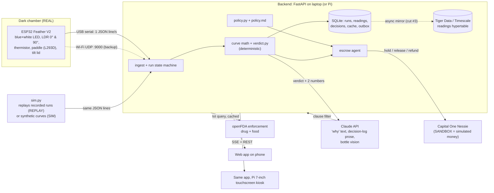

# Pill: software plan (Fri 2026-10-23, for the build Sat 02:00 → Sun 02:00)

Scope: riboflavin (vitamin B2) is the only calibrated reference; Tums should come out NEEDS LAB; anything else should come out UNABLE TO VERIFY. All code is written at the event. Peel ([write-up](https://plume.hackmit.org/project/qxodw-wgjqk-lidau-dxrpe), [repo](https://github.com/viktorinkov/HackMIT-2026)) is cited for method only; we copy no code. Every claim tagged "per Peel write-up" comes from that page.

## 1. Architecture



- **Firmware** measures and streams. It decides nothing: no verdicts, no thresholds beyond hardware faults.
- **Backend** owns the run state machine, the math, the verdict, the policy and every external call. It is the only component holding API keys.
- **Claude never sets a verdict or moves money.** It writes prose, and the escrow outcome comes from `policy.py`. A model reply can only downgrade an outcome to escalate, never upgrade it. Per Peel write-up, "the deterministic evidence has the final say."
- **Real vs simulated:** every run stores `src` ∈ `real | replay | sim`, and every screen shows a corner badge (`LIVE SENSOR`, `REPLAY of run B2-07`, or `SIMULATED`). Nessie shows `SANDBOX MONEY` everywhere, and recall results show `openFDA live` or `openFDA cache, fetched <date>`.
- **Time series:** SQLite is the source of truth because it works offline. Tiger Data ([tigerdata.com](https://www.tigerdata.com/), formerly Timescale) gets an async mirror of `readings` for the MLH track.

## 2. ESP32 JSON contract and run state machine

There are 9 required fields plus 4 envelope fields (`v`, `seq`, `state`, `src`). The firmware sends one line per second, newline-terminated, at 115200 baud.

```json
{"v":1,"seq":412,"src":"real","state":"running","t":63.0,"led":"blue","adc0":1874,"adc90":402,
 "temp_c":24.6,"paddle":180,"dark":[96,88],"blank":[2911,371],"fault":null}
```
| field | type | meaning |
|---|---|---|
| `t` | float s | seconds since the firmware received `S` (start); 0 before start |
| `led` | `"blue"\|"white"\|"off"` | LED lit during this second's sweep |
| `adc0` | int 0–4095 | LDR in line with the beam (transmission), mean of 24 samples (per Peel write-up, 24-sample averaging), dark not subtracted |
| `adc90` | int 0–4095 | LDR at 90° (scatter/cloudiness), same averaging |
| `temp_c` | float | thermistor (Steinhart–Hart, B-value from the part's datasheet) |
| `paddle` | int 0–255 | commanded PWM duty on the L293D; 0 = off |
| `dark` | [int,int] | `[adc0, adc90]` with the LEDs off, taken just before this sweep (per Peel write-up, a dark reading before every sweep) |
| `blank` | [int,int]\|null | `[adc0, adc90]` on plain water, latched by the `B` command; null until taken |
| `fault` | null\|string | `LID_OPEN` (tilt switch or dark0 > 400), `ADC_SAT` (≥ 4000), `TEMP_RANGE` (< 15 or > 40 °C), `THERM_OPEN`, `LED_DEAD` (blank0 − dark0 < 300), `BROWNOUT` (reset cause) |

Commands from the backend over serial are single characters (per Peel write-up, single-byte commands): `D` dark, `B` blank, `S` start (paddle on, t=0), `X` stop, `1` blue, `2` white, `R` reset. Lines that fail to parse are counted and shown as a "serial noise" figure. They are never interpolated.

**State machine** (owned by the backend; `state` in the JSON line echoes it for debugging):
```
idle --tap Blank--> dark   (LEDs off 3 s; dark0 > 400 or tilt → fault LID_OPEN → stays idle)
dark --ok--> blank         (plain water, paddle on, 10 s; CV(adc0) < 2 % else "unstable blank, retry")
blank --tap Start--> running   (t0 = first sample where adc0 drops ≥ 6 % below blank0, per Peel write-up's drop detection; no drop in 30 s → prompt "drop the tablet")
running --20 s window |dA/dt| < ε--> plateau --> verdict
running --t - t0 > T_timeout--> timeout --> verdict
any state --fault--> fault (run kept, raw trace kept) --> verdict = UNABLE TO VERIFY
```
**Math** (per Peel write-up: absorbance against a blank on plain water, then plateau, % released and time-to-80 %):
`A(t) = log10((blank0 − dark0) / (adc0 − dark0))`
`S(t) = (adc90 − dark90) / (blank90 − dark90) − 1`
`bar % = 100 · A(t) / A_ref`, where `A_ref` is the calibrated median plateau
`t80` = first t where `A ≥ 0.8 · A_plateau`.
LDRs are nonlinear, so `A` is an *apparent* absorbance used only for comparison against the same rig. We never convert it to mg or claim a concentration.

**Verdict rules** (`verdict.py`, evaluated in order; the first rule that matches wins, and the rule id goes on the card):
1. U1 no reference for the drug from the bottle or a manual pick (`references.json` has only `riboflavin`) → **UNABLE TO VERIFY**
2. U2 any `fault` during the run, including `LID_OPEN` → **UNABLE TO VERIFY**
3. U3 temperature outside the calibration range ±3 °C, or fewer than 30 s of samples → **UNABLE TO VERIFY**
4. N1 peak `S` > τ (cloudy; the Tums rule) → **NEEDS LAB**
5. N2 timeout with no plateau, or plateau `A` < LOD (`3·SD` of `A` during the blank, per Peel write-up's detection limit from blank noise) → **NEEDS LAB**
6. N3 plateau `A` outside `[A_lo, A_hi]` → **NEEDS LAB**
7. P1 plateau inside the band, `S` ≤ τ, no faults → **PASS** ("consistent with the riboflavin reference: this lot, one tablet")

## 3. Calibration tonight (Sat 02:00–04:00, hardware lead plus `logger.py`)
1. Use the same cup, water volume (marked line), paddle duty and LED for every run. Warm water to about 30 °C in advance and log the temperature. Lid closed. Run `D`, `B`, drop the tablet, `S`, and wait until plateau or 10 min.
2. Do **10 B2 runs**, then **3 Tums runs** and **2 unknown-pill runs** (any non-B2 tablet). Each run saves to `recordings/<label>-<nn>.jsonl` with a header line `{label, tablet, water_ml, temp_start, notes}`.
3. `calibrate.py` computes plateau `A_p`, peak `S` and `t80` for each run and writes `references.json`:
   - Band: `μ ± 3σ` of the 10 B2 plateaus. Check it with **leave-one-out**: each B2 run must land inside the band built from the other 9. Report "10/10 LOO" or the honest count.
   - Scatter τ = midpoint of (max B2 peak S, min Tums peak S). Rule N1 is valid only if min Tums S > 2 × max B2 S. If not, drop N1 and say so in the README.
   - `T_timeout = 1.5 × max B2 time-to-plateau`, with a 300 s default. If B2 takes more than 4 min, switch to a pre-split half tablet for every calibration run and every demo run, and say so aloud.
   - Gate (from `final-2026-10-23.md`): CV(`A_p`) ≤ 15 % and CV(`t80`) ≤ 15 % by 03:00. Otherwise demo pass/fail on plateau only, or fall back to Bill.
   - Unknown pills: if one lands in-band with low S, write it down as a known false-pass mode. Rule U1 (the drug from the bottle has no reference) is what stops it in practice.
4. Print the 15 curves on one PNG (`docs/calibration.png`) for the Devpost page and slides.

## 4. Backend endpoints (FastAPI, Python 3.11; numpy, `sse-starlette`, `anthropic`, `httpx`, `reportlab`)
| endpoint | does |
|---|---|
| `POST /runs` | `{mode, drug, lot, delivery_id?, src}` → creates the run, sends `D`/`B` to the serial port (or starts the sim), returns `{id}` |
| `POST /runs/{id}/start`, `/stop` | sends `S` / `X` |
| `GET /runs/{id}/stream` | SSE, one event per line: raw fields plus derived `A`, `S`, `bar_pct`, `state`, and `ref_band` on the first event; final event `verdict` |
| `POST /bottle` | multipart photo → Claude vision → **allow-list** `{drug, strength, lot, expiry, manufacturer, ndc, confidence}`; every other key is dropped server-side and the image is deleted after extraction (per Peel write-up, personal details stripped). Fields stay editable |
| `GET /recalls?drug&lot` | `https://api.fda.gov/drug/enforcement.json?search=code_info:"<lot>"` plus `food/enforcement.json` (B2 tablets are supplements). A hit counts only if the lot matches exactly and the product or firm matches too (per Peel write-up, lot strings collide across makers). Response: `{status: hit\|no_record\|unreachable, records[], source: live\|cache, fetched_at}`. `no_record` reads "no openFDA record for this lot", never "clear" |
| `POST /decisions` | escrow agent; see §6. Body `{run_id, delivery_id}`. Stores `{inputs, policy_clause, outcome: release\|hold\|escalate, amount, spend_cap, escalate, nessie_transfer_id, status: proposed\|executed\|queued, approved_by}` |
| `POST /decisions/{id}/approve` | pharmacist tap; the only path that executes a release |
| `GET /deliveries`, `POST /deliveries` | `{supplier, lot, drug, amount}`; creating one moves funds clinic → escrow in Nessie (hold) |
| `GET/POST /medicines`, `POST /medicines/{id}/taken` | personal mode |
| `GET /report/{id}.pdf` | reportlab: curve PNG, band, the two numbers, verdict, rule id, recall result, decision log, src badge |

Nessie (docs: [api.nessieisreal.com](https://api.nessieisreal.com/), resources include customers, accounts, transfers, deposits, withdrawals): there are 3 accounts (Clinic, Pill Escrow, Supplier). Hold = transfer Clinic→Escrow when the delivery is created. Release = Escrow→Supplier after approval. Refund = Escrow→Clinic. Escalate = no transfer. Exact request field names [unverified]; the docs need an API key to open.

## 5. Web app screens (Vite + React + Recharts, served by FastAPI `StaticFiles`; the same URL runs on the phone and on the Pi in Chromium `--kiosk`)
- **Home:** a big clinic/personal switch (stored in localStorage and sent with every run), an src badge, and a "Start scan" button the size of half the screen.
- **Scan:** the bar shows "dissolving… 62 % of expected riboflavin plateau". The live `A(t)` curve sits over the dotted reference band. Beside it: scatter `S` sparkline, water temp, elapsed s, and four dots (LED baseline, dark current, paddle, lid). The empty and fault states are designed **first** (idle, dark, blank, running, fault). On fault, the bar freezes grey and the fault code is named in plain words.
- **Verdict card:** full screen. Green **PASS**, amber **NEEDS LAB** or grey **UNABLE TO VERIFY**, plus the one-line Claude "why", the two numbers that decided it (e.g. "plateau 0.41 (band 0.36–0.47) · scatter 0.03 (limit 0.12)") and the rule id. No red, no "safe".
- **Bottle:** camera input → the extracted fields (editable) → recall result chip (`no openFDA record` / `RECALL: <recall_number>` / `lookup unavailable, cache from <date>`).
- **Clinic: Delivery:** lot, supplier, `$ held (SANDBOX)`, the spend cap, the decision log (time, inputs, quoted clause, outcome), and three buttons: Release (enabled only when the policy outcome is release and the amount is within the cap), Hold, Escalate.
- **Personal: My medicines:** one row per bottle with drug, lot, the verdict of its one tested tablet, recall status and the date checked, plus a "Taken" tap that logs a timestamp. A banner reads "Measuring a dose needs the station; this list does not re-test."
- **Report:** a web view of the PDF content with Download and Share.

## 6. Claude prompts (current Sonnet model; check the console at the event; [vision docs](https://docs.anthropic.com/en/docs/build-with-claude/vision))
**"Why" (system):** "You explain a screening result from a tablet dissolution test to a pharmacist. You receive JSON: verdict, rule_id, plateau, band, scatter, tau, temp, faults, recall_status. Write at most 2 sentences, grade-8 English. Restate only what the numbers show and what to do next (send to lab / retest / proceed under clinic policy). Never describe the medicine's quality, authenticity or safety. Do not use the words safe, genuine, fake or counterfeit. If any input is missing or contradicts the verdict, reply exactly: `Unable to verify: <which input>.`"
**Filter (code, not prompt):** split the reply into clauses on `. ; : , —` and the words `but`, `and`, `so`. Drop any clause matching `\b(safe\w*|genuine\w*|fake\w*|counterfeit\w*)\b` (case-insensitive). If more than half the clauses are dropped, or the remainder doesn't mention the verdict's next step, use the deterministic template from `templates.py`. Per Peel write-up, Peel filters such words "at the clause level"; this filter is written fresh.
**Escrow (system):** "You are the escrow clerk for a clinic. Policy (quoted verbatim): <<<policy.md>>>. Input: verdict, rule_id, recall_status, amount, spend_cap, proposed_outcome (from policy.py). Return JSON `{outcome, clause_id, clause_quote, log_line}`. outcome must equal proposed_outcome or be `escalate`. If anything is unclear, choose `escalate`. You never release funds; a human approves releases." Code validates the JSON. A parse failure, an unknown clause_id or any outcome other than proposed/escalate becomes `escalate`. `log_line` passes through the same clause filter.
**`policy.md` (clauses):** P1 a release needs PASS + recall_status `no_record` + amount ≤ spend_cap (default $500 sandbox) + the pharmacist's tap. P2 NEEDS LAB → hold and draft a lab referral. P3 UNABLE TO VERIFY → escalate, no money moves. P4 a recall hit → hold regardless of the verdict. P5 amount > cap → escalate. P6 recall lookup `unreachable` → hold until a lookup succeeds or a human overrides.

## 7. Offline plan (venue Wi-Fi is weak)
- **Pi as access point:** `nmcli device wifi hotspot ssid PILL password …` on the Pi 3 (if its SD card has an OS; otherwise the laptop runs a hotspot). The phone joins PILL and opens `http://10.42.0.1:8000`. The ESP32 stays on USB to the backend host, so measurement never needs Wi-Fi.
- **openFDA cache:** `seed_cache.py` stores every demo lot plus all riboflavin/vitamin B2 records from drug and food enforcement in `recall_cache` with `fetched_at`. Lookups go live with a 3 s timeout, then fall back to the cache, which is labelled as cache. One live lookup that shows a visible `no_record` case is kept for the Bright Data/Anthropic judges.
- **Nessie:** each call is written to an `outbox` row first, retried at 2/4/8/30 s, and shown in the UI as `queued (sandbox offline)`. The account balances are cached so the Delivery screen always renders.
- **Claude:** 3 s timeout, then the deterministic template (`templates.py`), labelled "template". **Pre-signed fallback:** for the 3 demo scenarios (B2 / Tums / unknown), `fallback/*.json` stores the pre-generated "why", the decision-log line and the Nessie transfer ids, each with a sha256 and its generation time, shown with a `CACHED` badge. A recorded fallback video sits on the laptop desktop.

## 8. Repo layout (`~/calhacks-13/pill`, git repo created Sat 02:00)
```
pill/
  firmware/pill_esp32/pill_esp32.ino   # sweep, dark, blank, faults, commands; arduino-cli
  backend/app.py  serial_io.py  state.py  curve.py  verdict.py  policy.py  claude.py
  backend/recalls.py  nessie.py  report.py  db.py  sim.py  calibrate.py  seed_cache.py  templates.py
  backend/references.json  backend/fallback/  backend/tests/
  recordings/            # tonight's 15 runs, .jsonl
  web/                   # Vite React app
  policy.md
  README.md              # "Built on Peel" (cited); "Where each sponsor tool is used"; "Real vs simulated"
  docs/calibration.png
```
README "Where each sponsor tool is used": Anthropic (`claude.py`: why, escrow log, bottle vision) · Capital One Nessie (`nessie.py`) · Tiger Data (`db.py` mirror) · openFDA (`recalls.py`) · Espressif/hardware (`firmware/`).
README "Real vs simulated" table: sensor readings real (or replay/sim, badged) · money is Nessie sandbox · recall data is real openFDA, live or cached with a date · there is one reference drug · no antimalarial has been tested.

## 9. Work split, 2 developers (A = firmware/math/integrations, B = backend core/web)
| Sat/Sun | Dev A | Dev B |
|---|---|---|
| 02:00–04:00 | run the 15 calibration runs with `logger.py`; firmware faults + commands | repo, FastAPI skeleton, SQLite schema, `serial_io.py`, `sim.py` replay, SSE |
| 04:00–08:00 | sleep | sleep (after replaying the first real files end to end) |
| 08:00–10:00 | `calibrate.py` → `references.json`; `verdict.py` + LOO tests | **Scan** screen against the sim: bar, curve vs band, scatter, temp, dots, all states |
| 10:00–12:00 | lid tilt fault, Pi kiosk + hotspot, real box → SSE end to end | **Verdict** card, `claude.py` why + clause filter + templates, **Home** mode switch |
| 12:00–14:00 | `/bottle` vision + allow-list, `/recalls` + `seed_cache.py` | `policy.md`, `policy.py`, `/decisions`, `nessie.py` + outbox, **Delivery** screen |
| 14:00–16:00 | `report.py` PDF; Tiger Data mirror | **Bottle** screen; **My medicines** + Taken log |
| 16:00–18:00 | both: 3-tablet sequence on the real box ×10 under venue light; **feature freeze 18:00** | ← same |
| 18:00–22:00 | bug fixes; generate `fallback/*.json`; offline drill (Wi-Fi off) | bug fixes; src badges on every screen; record the fallback video with Pitch |
| 22:00–00:00 | README sponsor + real-vs-sim sections; calibration.png | Devpost screenshots; Report screen polish |
| 00:00–02:00 | final offline drill; tag `v1.0` | final offline drill; staged phones/Pi |

**Checkpoints:** 10:00 the sim stream renders on Scan; 12:00 a real tablet → verdict; 14:00 Delivery release/hold/escalate against Nessie. If a checkpoint is missed, cut in this order: **(1) PDF report** (the Report screen becomes HTML print), **(2) personal mode**, **(3) Tiger Data**, **(4) bottle vision** (manual drug/lot entry; recall lookup stays). Never cut **scan + verdict + escrow**.

## 10. Test plan: build the app before the box works
- `sim.py --replay recordings/B2-03.jsonl --speed 1|10` writes the same JSON lines into the ingest path; the badge reads `REPLAY of B2-03`. Before the recordings exist, `sim.py --synthetic b2|tums|unknown` generates `A = A∞(1 − e^{−k(t−t0)})` plus noise (Tums: A ≈ 0, S rising to 0.5) so Dev B can start at 02:00.
- Fault injection (per Peel write-up, their software board had every fault injectable; ours is written fresh): `--lid-open-at 40`, `--saturate-at 30`, `--garble 0.05`, `--drop 0.05`, `--temp 45`, `--no-blank`.
- `pytest backend/tests`:
  - every B2 recording → PASS (leave-one-out bands)
  - every Tums recording → NEEDS LAB, rule N1
  - unknown drug → UNABLE TO VERIFY, rule U1
  - injected lid open → UNABLE TO VERIFY, rule U2
  - garbled lines are counted, never crash the run
  - clause filter strips all 4 banned words in 20 crafted replies
  - an escrow reply of "release" when policy says hold → hold or escalate
  - Nessie down → outbox queued
  - openFDA down → cache with date
- Manual drill before the freeze: the three-tablet demo on the real box, then the same flow on replay with Wi-Fi off, both timed under 90 s.
