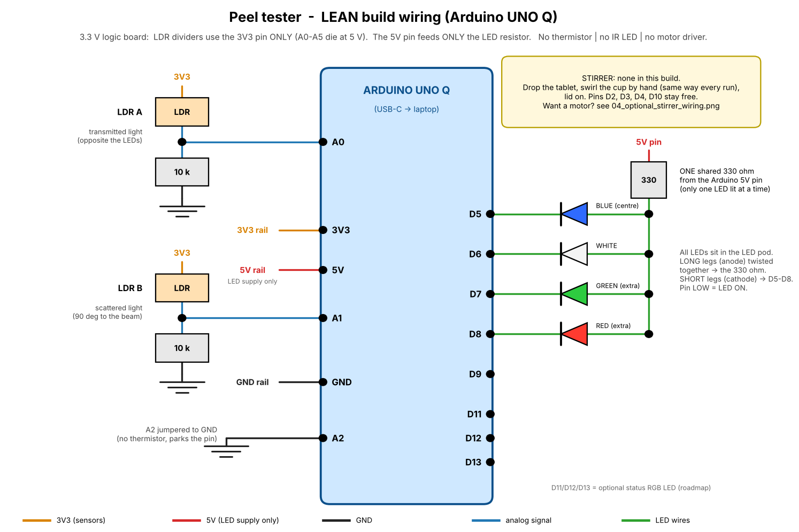
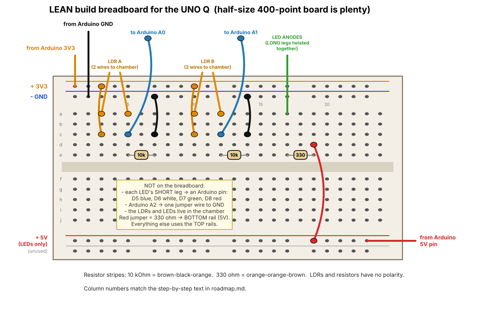
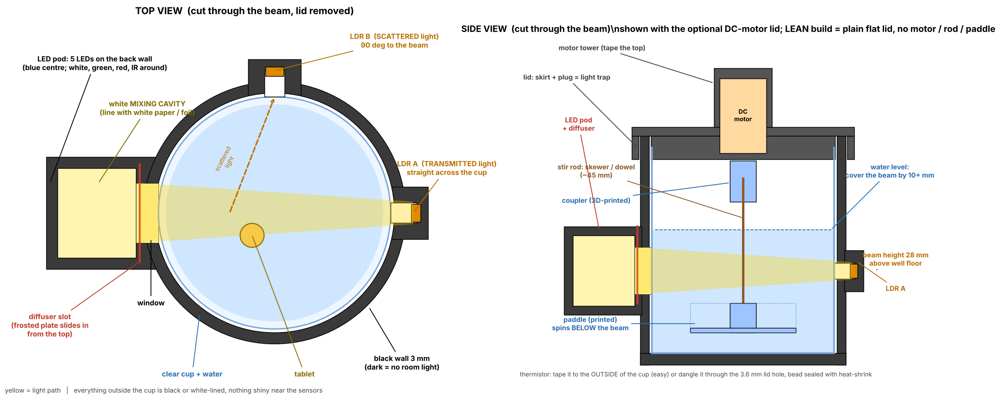

# Peel-style Pill Gate — Hardware Roadmap (LEAN build for the **Arduino UNO Q**, v3)

Cal Hacks 13.0 · Oct 23–25, 2026 · Palace of Fine Arts · **submit by Sun Oct 25, 9:00 AM PT** (be at the venue by 8)
Hardware lead: Aaron · Software lead: teammate

> **v3 = UNO Q edition.** The earlier versions assumed a classic UNO R3 (5 V). The UNO Q is a **3.3 V** board, so three things changed: the photoresistor dividers run from the **3V3** pin (the analog pins can be damaged by 5 V), the LEDs are wired **active-low** with one 330 Ω resistor to the **5V** pin, and readings are **12-bit (0–4095)** instead of 10-bit (0–1023). Everything else (chamber, curves, demo) is unchanged.
>
> **Lean build:** no thermistor (you type the water temperature), no IR LED, no motor (you stir the cup by hand with a wooden stick). The thermistor option is kept as a marked add-on.
>
> I assumed "Bill" = **Peel**, the optical pill-dissolution tester (HackMIT 2026 grand prize). If you meant something else, tell me. Peel is someone else's project: **cite it openly in the Devpost, write every line of code fresh this weekend, don't copy their repo.**

---

## 0. Read this first (60 seconds)

**What the box does:** a tablet dissolves in a cup of water inside a dark chamber. LEDs shine through the water; two photoresistors measure how much light goes straight through and how much scatters sideways, once per second. The curve ("how fast, in what shape did it dissolve") is compared to a reference curve recorded from a known-good tablet → **"consistent with reference / needs lab / can't verify."**

**What it does NOT do (say this in the pitch — it protects you in Q&A):**
- It does **not** identify ingredients. It checks *how a pill behaves*, not what's in it. Confirmation needs a real lab (HPLC / Raman / NIR).
- It is a **screening** tool. It never "certifies" medicine.
- Build and demo with **OTC vitamins only** (riboflavin/B2 as the reference, a different tablet as the "fake").

**The three UNO Q rules (print these):**
1. **Never connect 5 V to A0–A5.** Sensors use the **3V3** pin. (Arduino's datasheet lists the analog pins as ~3.3 V only.)
2. **5V pin → only the LED resistor.** Nothing else touches 5 V.
3. After **Upload**, a line `Error: verify failed in bank at 0x08000000 …` is **normal on the UNO Q** (see §5). Judge success by the Serial Monitor, not by that line.

**Files in this folder**

| File | What it is |
|---|---|
| `roadmap.md` | this document |
| `diagrams/01_wiring_overview.png` | whole circuit, one picture (UNO Q) |
| `diagrams/02_breadboard_layout.png` | exact breadboard holes (UNO Q) |
| `diagrams/03_chamber_cross_sections.png` | the chamber inside (top + side) |
| `firmware/peel_firmware/peel_firmware.ino` | Arduino code, **v1.0-nomotor** (blue + white + red, no motor code) — open this one file in the Arduino IDE |
| `app/` | **the software app** (Peel-style): bottle + tablet photos, live dissolution graph, verdict, recall lookups, Ask, issue reports, 3D atlas — see `app/README.md` and §13 |
| `tools/live_log.py` | live serial → CSV logger with optional live graph (works without the app) |
| `cad/peel_chamber.scad` + `peel_*.stl` | parametric chamber: body, plain lid, diffuser, cup shim rings (`peel_plate_complete.stl` = the one-print plate) |
| `tools/overlay.py` | overlays runs, prints t50 and spread (your go/no-go test); reads text pasted from the Serial Monitor |
| `tools/capture.py` | optional pyserial recorder — **untested on the UNO Q** |

---

## 1. Parts check

**✅ = you told me / I saw it · ⚠️ = confirm · ❌ = you don't have it**

| Part | Qty | Needed? | Status |
|---|---|---|---|
| **Arduino UNO Q** + USB-C cable | 1 | **yes** | ✅ |
| Breadboard + jumper wires (M-M **and** M-F dupont) | lots | **yes** — M-F wires slip onto LED/LDR legs | ✅ |
| **Photoresistors (LDR, CdS)** | 2 | **yes** | ✅ you have them |
| 10 kΩ resistors (brown-black-orange) | 2 | **yes** | ⚠️ count them |
| **330 Ω resistor** (orange-orange-brown) | 1 | **yes** — the LED resistor. 470 Ω is fine (dimmer); two 220 Ω in series = 440 Ω also fine. A single 220 Ω is probably OK too, but Arduino doesn't state a per-pin current limit in what I read, so I picked the safer value | ⚠️ |
| Blue + white 5 mm LEDs | 1 each | **yes** | ✅ |
| Green + red 5 mm LEDs | 1 each | nice to have (extra colors) | ✅ |
| **Rectifier diode 1N400x** | 1 | not needed (no motor in this build) | ✅ you have it |
| Raspberry Pi 3 + 7" touchscreen | 1 | optional — the UNO Q has its own Linux side; the Pi/laptop is just the dashboard | ✅ |
| **Clear cup/jar**, smooth round sides, about 55–75 mm wide and **at most ~62 mm tall for the default chamber** (the chamber depth is set to cup height + 12 mm because the lid plug dips 8 mm into the well; taller cups need `well_h` raised) | 1 | **yes** — **measure it BEFORE printing** | ⚠️ you have none yet |
| Thermometer (kitchen / fever) | 1 | optional (replaces the thermistor) | ⚠️ |
| Thermistor NTC | — | optional | ❌ |
| IR LED | — | **skip** (photoresistors barely see 940 nm) | ❌ |
| RGB LED | 1 | optional pass/fail light | ✅ |
| DHT11 module, IR receiver module, 7-segment displays | — | **not used** | ✅ |
| Black filament (+ white/natural for the diffuser) | — | for the 3D-printed chamber | ⚠️ |
| Hot glue, black tape, white paper or foil, matte black paint/marker | — | finishing | ⚠️ |
| Riboflavin (vitamin B2) tablets + one other OTC tablet (e.g. vitamin C) | 4–8 | **yes** — reference + stand-in "fake" | ⚠️ ~$4 at a drugstore |

---

## 2. How the pieces talk

```
 ┌──────────── 3D-printed dark chamber ────────────┐
 │  LEDs ─► mixing cavity ─► diffuser ─► [ cup ] ─► LDR A (straight through)
 │                                         │  └──► LDR B (scattered, 90°)
 │   you swirl the cup by hand at t = 0    │
 └─────────────────────┬────────────────────────────┘
                       │ ~9 wires
               ┌───────▼────────┐  USB-C → laptop: Arduino IDE Serial Monitor, 1 CSV line/s
               │  Arduino UNO Q ├──────────────────────────────────────► copy/paste to a .csv
               └────────────────┘                                          │ overlay.py → curve → match
                                                                           ▼
                                                           dashboard  +  teammate's cloud/AI side
```

One CSV line per second (the firmware prints it):

```
ms,dark_a,dark_b,B_a,B_b,W_a,W_b,temp_c,stir
12345,35.20,12.10,2440.50,570.25,3250.00,810.75,36.50,0
```
`dark_*` = both LDRs with every LED off (room light leaking in). `B_a` = LDR A while blue is on. **Net signal = B_a − dark_a** (removes room light). Values are **0–4095** (12-bit); the example numbers are illustrative. `temp_c` = the temperature you set (`K36.5` command or the `DEFAULT_TEMP_C` line in the sketch), else `nan`. `stir` = 0 in the lean build.

---

## 3. Pin map (print this, tape it to the box)

| UNO Q pin | Goes to | Notes |
|---|---|---|
| **3V3** | breadboard **top + rail** | feeds the two LDR dividers. **This is the only sensor supply.** |
| **GND** | breadboard **top − rail** | everything shares this ground |
| **5V** | breadboard **bottom + rail** | **LED resistor only** |
| **A0** | LDR A node | transmitted light |
| **A1** | LDR B node | scattered light |
| **A2** | **GND** (one jumper) | parks the unused thermistor input |
| **D5** | blue LED **short** leg (cathode) | LOW = LED on |
| **D6** | white LED short leg | |
| **D7** | green LED short leg | extra color |
| **D8** | red LED short leg | extra color |
| D9 | leave empty | was the IR LED |
| D11 / D12 / D13 | RGB status LED R / G / B (each via 220 Ω) | optional |
| D2, D3, D4, D9, D10 | **leave free** | not used. **Don't put LEDs on D3** (it is one of the pins I read as not 5 V-tolerant) |

All LED **long legs (anodes)** twisted together → **one 330 Ω** → **5V pin**.



**Why active-low?** Blue and white LEDs need roughly 3 V to light. A 3.3 V pin driving them from the high side would barely light them. Instead the 5V pin pushes current through the LED and the Arduino pin *sinks* it: pin LOW = LED on. The firmware releases the pin (input / high-Z) when the LED is off, so a red LED doesn't glow faintly from a 3.3 V "HIGH".

---

## 4. Wiring, step by step (test after every step)

**Rules:** unplug USB while wiring. Long LED leg = anode (+). Resistors and LDRs have no polarity. **Upload the firmware (§5) first** — then every step has a test you can read in the Serial Monitor.

Breadboard picture (column numbers match the text):


### Step 1 — Power rails (3 min)
1. Arduino **3V3** → top **+** rail (orange line in the picture).
2. Arduino **GND** → top **−** rail (blue line).
3. Arduino **5V** → **bottom +** rail (red line). Nothing else goes on the bottom rails.

*Test:* plug in USB-C. Board powers up, nothing is warm. (With a multimeter: top + rail ≈ 3.3 V, bottom + rail ≈ 5 V. If you have one, check — it's the cheapest insurance on this board.)

### Step 2 — LDR A, the "straight through" sensor (5 min)
Circuit: `3V3 — LDR — node — 10 kΩ — GND`, node → **A0**.
1. Jumper: top **+** rail → **col 3, row c**.
2. Jumper: **col 7, row c** → top **−** rail.
3. 10 kΩ resistor: **col 5 row e → col 7 row e**.
4. Wire: **col 5 row c → Arduino A0**.
5. The LDR itself lives in the chamber. Push a female dupont wire onto each LDR leg (hot glue, heat-shrink or tape over it). Lead 1 → **col 3 row a**, lead 2 → **col 5 row a** (either way round).

*Test:* open the Serial Monitor. Look at the `dark_a` and `B_a` columns. Cover LDR A with a finger → `dark_a` drops; shine a phone light on it → it climbs. You want a big, smooth change (hundreds of counts out of 4095). If you can send commands, `V1` prints `live,<A0>,<A1>` five times a second; `V0` stops it.

### Step 3 — LDR B, the "scatter" sensor (5 min)
Same as Step 2, shifted: **+** rail → **col 10 row c**; **col 14 row c** → **−** rail; 10 kΩ **col 12 row e → col 14 row e**; wire **col 12 row c → A1**; LDR leads → **col 10 row a** and **col 12 row a**.

*Test:* now `dark_b` reacts when you cover LDR B.

### Step 4 — LEDs (10 min)
1. Twist all the **long legs (anodes)** together → one wire → **col 17 row a**.
2. 330 Ω: **col 17 row e → col 19 row e**.
3. Red jumper: **col 19 row d → bottom + rail (5V)**.
4. Each **short leg (cathode)** gets its own wire straight to the Arduino: **D5** blue, **D6** white, **D7** green, **D8** red. *(Blue + white are the ones the test uses; green/red are extras.)*

*Why one shared resistor?* The firmware lights exactly one LED at a time. Estimated current is roughly 6 mA (blue/white) to 9 mA (red/green): (5 V − forward voltage) / 330 Ω. **Those are my estimates from typical LED voltages, not measurements.**

*Test:* at every reset the firmware flashes **blue, white, green, red** for 0.4 s each (`BOOT_LED_TEST`). Press the board's reset button and watch the LED pod. An LED that never lights is backwards: swap its legs. A *wrong-but-lit* result (all LEDs light together, or nothing at all) usually means the anode twist isn't going through the 330 Ω. In the CSV, `B_a − dark_a` should be clearly positive once the LED points at LDR A.

### Step 5 — Park the unused thermistor pin (30 s)
One jumper wire from Arduino **A2 → Arduino GND**. Without it, A2 floats and (if you ever turn the thermistor on) the temperature column fills with garbage.

*Test:* `temp_c` shows `nan` (or the `DEFAULT_TEMP_C` you set). With commands: `K36.5` then `T` → `36.50`.

### Step 6 — Optional status RGB LED (5 min)
Each color leg → 220 Ω → **D11** (R), **D12** (G), **D13** (B); the common leg → **GND** (common-cathode). If yours is common-anode, wire it to **3V3** and set `STATUS_COMMON_ANODE = true` in the firmware. *Test (needs commands):* `CG` green, `CR` red, `CY` yellow, `CO` off.

### Stirring
No motor in this build: **stir by hand with a wooden stick**, the same way every run (§8).

### Optional — thermistor
10 kΩ NTC: `3V3 — 10 kΩ — node — NTC — GND`, node → A2 (**remove** the A2→GND jumper), set `USE_THERMISTOR 1`. Constants assume 10 kΩ, B = 3950 — unverified for your part.

### Wiring troubleshooting

| Symptom | Likely cause |
|---|---|
| A0/A1 stuck near 0 or near 4095 | LDR leg not in the node column / resistor missing / LDR lead not in the right column |
| A0 jumpy for no reason | loose dupont on the LDR leg (hot-glue it) |
| One LED dim / dead | backwards, or its short leg on the wrong pin |
| All LEDs always on | the pins aren't being released: check you uploaded the latest firmware and `BOARD_UNO_Q` is 1 |
| `temp_c` is random numbers | thermistor on but A2 not wired — set `USE_THERMISTOR 0` |
| Board resets / USB drops | a wire shorting 5V to GND — recheck rails |
| Board gets warm / readings freeze after wiring | **stop** — 5V may be on an analog pin. Unplug, trace the 5V wire |

---

## 5. Firmware (Arduino IDE) — UNO Q specifics

1. **Arduino IDE 2.x** → Tools ▸ Board ▸ **Arduino UNO Q** (it comes from the UNO Q board package; the IDE offered it when you first plugged in the board — keep it up to date, core ≥ 0.55 is what I read about). Pick the port.
2. Open `firmware/peel_firmware/peel_firmware.ino` → **Upload**. No extra libraries from you.
3. **The scary-looking line is normal.** At the end of the upload the log says:
   `Error: verify failed in bank at 0x08000000 starting at 0x00100000 … shutdown command invoked`.
   On the UNO Q, uploads run OpenOCD on the board itself, and users on Arduino's forum report this same message while the sketch runs fine ([forum thread](https://forum.arduino.cc/t/arduino-uno-verify-failed-in-bank/1451257); related: [core 0.55 migration note](https://support.arduino.cc/hc/en-us/articles/27251870677916-Migrating-to-Zephyr-core-0-55-0-on-UNO-Q)). A line like `Sketch uses 78632 bytes (9%)` means it compiled.
   **Success = the Serial Monitor shows the banner.**
4. Tools ▸ **Serial Monitor**, **115200**, line ending **Newline**. Wait ~5 s (the Linux side boots; the sketch waits 2.5 s on purpose). You should see:
   - `# PEEL optical fingerprint firmware v1.0-nomotor`
   - `# build: board=UNO_Q … adc_bits=12 adc_max=4095`
   - the LED self-test line, then the CSV header (`ms,dark_a,…`), then one line per second.
   If it's empty: press the board's reset button, close and reopen the Serial Monitor, check the right port is selected.
5. **Build options** are lines at the top (defaults = lean build on the UNO Q, no edit needed):
   - `BOARD_UNO_Q 1` (set 0 only for a classic UNO R3 — see Appendix A)
   - `USE_THERMISTOR 0`
   - `DEFAULT_LEDS 0x0B` (blue + white + red)
   - `DEFAULT_TEMP_C NAN` → type your water temp, e.g. `36.5`, if commands don't work
   - `BOOT_LED_TEST 1`

| Command | Does |
|---|---|
| `?` | help |
| `LBWR` / `LBW` | which LEDs each sample uses (default **Blue + White + Red**) |
| `K36.5` | water temperature you read on a thermometer; goes into every CSV line |
| `R1000` | sample period in ms (300–60000) |
| `G1` / `G0` | stream CSV on / off |
| `T` | one sample now |
| `DB` `DW` … / `D` | hold an LED on for aiming / all off |
| `V1` / `V0` | live A0/A1 view |
| `CG` `CY` `CR` `CO` | status LED |

**Whether the IDE's Serial Monitor can *send* commands to the UNO Q is untested.** That's why measurement doesn't depend on them: the CSV streams by default with blue, white and red, and temperature can be set in the sketch.

**What I could and couldn't check:** I compiled v1.0 against a stub Arduino library (UNO Q and UNO R3 × thermistor on/off), no warnings, and simulated the commands, CSV format and active-low LED behavior. **I have not run it on a real UNO Q.** Unverified: that `analogReadResolution(12)` gives full 0–4095 on your core, the ADC reference being 3.3 V, how fast the board's Serial Monitor bridge runs at 1 line/s (should be fine), and the thermistor constants. (You have since confirmed on the real board that uploading, the LEDs and both sensors work.)

Why it's built this way: `dark` is read every sample, so a lifted lid or phone flash doesn't ruin the curve; each value is the average of 128 ADC reads; LED settle time is 120 ms because CdS photoresistors are slow (fine at 1 reading/s, not at 100). There's deliberately **no `pinMode()` on A0–A2** (it can break analog reads on this core).

---

## 6. The chamber (unchanged by the UNO Q)

### 6a. Quick version first (30 min, cardboard) — do this tonight

```
        TOP VIEW (lid off)                     black tape on the INSIDE of everything
   ┌────────────────────────────┐
   │  [LEDs]──tube──┐   ┌─tube──[LDR A]   LEDs: blue + white (+ green/red) in a bundle,
   │  (blue+white,  │ ○ │                  2–3 cm behind a sheet of white paper (diffuser)
   │   white paper  │cup│                  tubes: black paper rolls ~2 cm long,
   │   in front)    └───┘                  so each LDR only sees the cup
   │                    └─tube─[LDR B]     LDR B at 90° from the beam
   └────────────────────────────┘
   box flap + black cloth = lid; wires leave through a taped slot
```
Matte black inside (marker or black paper); nothing shiny near the LDRs. This is enough to run the feasibility test (§8).

### 6b. 3D-printed chamber (the one you demo)



- **Dark:** 3 mm black walls, a lid with *two* light traps (outer skirt + inner plug), LDR pockets that look only into the cup, a probe hole you tape over.
- **Light spreads evenly:** the LEDs sit **21 mm behind** a window, in a white-lined **mixing cavity**, then pass through a frosted **diffuser plate**.
- **Two views of one dissolve:** LDR A (straight through) sees the water get cloudy/colored; LDR B (90°) sees scattered light.

**No cup yet? Print the "complete" plate** (`cad/peel_plate_complete.stl` / `.3mf`: body + plain lid + three cup shim rings with 58 / 64 / 70 mm holes, ~200 g, ~10 h standard — my estimate). The slimmer `peel_plate_universal` file is the same without the rings. **Universal plate details:** (`cad/peel_plate_universal.stl` / `.3mf`: body + plain lid, one print, black PLA). Its well is 78 mm wide and 80 mm deep, so it takes any clear cup or jar up to ~76 mm wide and ~68 mm tall (and at least ~45 mm tall, so the water can cover the beam). A narrower cup is centered with a wrap of cardboard or tape around it. A cup that is too tall can be cut down with scissors. It is bigger than the default chamber: ~116 × 90 × 84 mm body, roughly 160 g of PLA and 8–10 h at standard quality (my estimate; Bambu Studio shows the real number). **A 3D-printed cup does NOT work** — PLA is opaque and the measurement needs light through clear water; use a clear plastic cup (cut down to height), the bottom of a smooth clear water bottle, or a clear food container.

**Before you print:** measure your cup at beam height and set `cup_d` to the widest outside width and `well_h` = cup height + 12 mm at the top of `cad/peel_chamber.scad` (the STLs use a 62 mm cup, 74 mm well, i.e. a cup up to ~62 mm tall). Every part exports as a watertight mesh, but **nothing has been printed or test-fitted** — expect to nudge tolerances.

| Part | File | Print notes |
|---|---|---|
| Body (cup well + LED pod + 2 LDR bosses) | `peel_body.stl` | **black**, upright, 3+ walls, 15–20 % infill, 0.2–0.28 mm layers. ~102 × 76 × 78 mm. No supports intended; if the roof of the mixing cavity sags, support there only. |
| **Plain lid** (lean build) | `peel_lid.stl` | **black**, prints in use orientation. 11 mm tall. |
| Diffuser plate | `peel_diffuser.stl` | **white/natural**, 0.8 mm. Or 2–3 layers of baking paper / frosted tape in the slot |

Slicer: Bambu Studio for Bambu Lab printers, FlashPrint for Flashforge (OrcaSlicer also works for both). **Print the diffuser first (minutes), then the lid, then the body.** Whether the venue offers 3D printing is **unverified** — ask at the hardware desk. Keep the cardboard version running while the real one prints.

**Assembly (lean build)**
1. Test-fit your cup in the body. Sand if tight.
2. **LDRs:** from *inside* the well, push each LDR face-first into its pocket, legs through the two tiny holes. Hot-glue the legs outside. LDR A is straight across from the LED pod, LDR B on the side. If A0 saturates (near 4095), tape a little in front; if too weak, trim the tube.
3. **Mixing cavity:** line it with white paper or foil.
4. **LEDs:** push the LEDs through the back-wall holes, domes into the cavity — **blue in the center**, white / green / red around it. Twist the **long legs** together (→ 330 Ω → 5V), give each **short leg** its own wire. Black hot glue over the holes (room light leaks through clear LED bodies). The 5th hole (IR) gets a blob of black glue or tape.
5. **Diffuser:** slide the plate into the slot from the top; tape over the slot.
6. **Darken the well:** matte black. Shiny black PLA reflects.
7. **Plain lid:** tape over the 3.6 mm probe hole (or poke a thermometer through it for the run).
8. **Light-leak test:** lid on, room lights on: `dark_a` and `dark_b` should be small and not change when you wave a phone light around the seams. Tape any seam that leaks.

**Filling the cup:** the beam is 28 mm above the well floor. Fill to **~40 mm above the inside floor (≈ 100–110 mL for a 58 mm inner width — measure and mark it)** and use the same line every run.

**Heat:** water ≤ ~40 °C (PLA softens around 55–60 °C). Use the same temperature every run and log it.

---

## 7. How the numbers become a verdict (for you and your teammate)

```
net(t)   = LEDon_reading(t) − dark(t)
base     = median(net over the first ~10 s)        ← clear water, lid on
curve(t) = net(t) / base                            ← 1.0 = clear, drops as it clouds/colors
```
- **Lid-lift trick:** when you lift the lid to drop the tablet, `dark_a` jumps; those rows are dropped and `t = 0` is where `dark` falls back. `tools/overlay.py` does this, scale-free, so 12-bit and 10-bit data both work.
- **Reference:** record ≥ 3 runs of the riboflavin tablet in identical conditions. The spread between them is your tolerance.
- **Match score:** resample to 1 Hz, compare curves (RMS or DTW) plus key numbers (t50, final level, blue/white ratio — riboflavin is yellow, so I expect it to absorb blue more than white; §8 tests that).
- **Three outputs only:** consistent with reference · needs lab · can't verify. **Never "authentic."**

**Handoff to your teammate**

*Tonight (works with certainty):* in the Arduino IDE Serial Monitor, let a run go, **Ctrl+A, Ctrl+C**, paste into a text file (`ribo1.csv`). The file can contain timestamps, `#` comment lines and junk; `overlay.py` ignores them. Hand your teammate the CSV files.

*What the software side needs:*
```
POST /runs        { run_id, product_label, lot, temp_c, channels:{B_a:[…], B_b:[…], W_a:[…], W_b:[…]}, dark:{a:[…], b:[…]} }
GET  /runs/{id}   → { score, verdict: "consistent|needs_lab|cannot_verify", t50, reference_id }
```
From there it's their world: label photo → Claude for product/lot extraction, recall lookup, escrow release / withhold / escalate, shared map of failed lots.

*Later (stretch, **untested**):* the UNO Q's Linux side can run a Python app next to the sketch and talk to it over Arduino's bridge (`Bridge.provide`, `Bridge.call`, `Bridge.notify` in the Arduino_RouterBridge library, run through Arduino App Lab) — a way to log CSV and serve a web dashboard from the board itself. I know the API shape but have **not** found or run a working example, so treat it as a stretch goal, not a plan. `tools/capture.py` (pyserial) may also work if your laptop shows the UNO Q as a serial port; unverified.

---

## 8. The 60-minute feasibility test — do this BEFORE you commit

Everything above only matters if a tablet's dissolve curve is **repeatable** and **different from another tablet's**. Test that first, with the cardboard setup if the print isn't ready.

**Stick-stirring routine (identical every run):**
1. Same cup, same water amount (the marked line), same temperature.
2. Start a fresh run (reset the board; the CSV restarts). Wait 10–15 s with the lid on (clear-water baseline).
3. Lift the lid, drop the tablet in the center, **swirl 5 slow circles in about 5 s**, lid back on.
4. Don't touch it until the curve flattens.
Still water is slower and more variable than stirred water — that's the price of the lean build. If curves don't repeat, first suspects: different swirl, bubbles in the beam, tablet landed in a different spot.

**Capture and compare (laptop):**
1. Serial Monitor open, run goes, Ctrl+A, Ctrl+C → paste into `runs/ribo1.csv` (make a `runs` folder). Repeat for `ribo2`, `ribo3`, `vitc1`…
2. ```
   pip install matplotlib numpy
   python3 tools/overlay.py runs/ribo1.csv runs/ribo2.csv runs/ribo3.csv --chan B_a
   ```
   It prints `t50` per run and the spread, and plots the overlay. Use `--chan W_a` for white, `B_b` for the scatter channel.

| # | Test | How | Looks good if… |
|---|---|---|---|
| 0 | **Noise** | clear water, lid on, 5 min | net signal wanders only a few % |
| 1 | **Repeatability** | riboflavin tablet, **3 runs**, same swirl | curves overlay and `t50` spread is within roughly ±20 % |
| 2 | **Distinguishability** | a *different* tablet (vitamin C, etc.), 1–2 runs | its curve clearly differs (different `t50`, shape, or blue-vs-white ratio) |
| 3 | **Time** | how long riboflavin takes to settle | ≤ ~5 min is demo-friendly. If slow: warmer water (≤ 40 °C), a quick-dissolving tablet, or stir a bit longer at the start (same every run) |

Those thresholds (±20 %, ≤ 5 min) are **my rule of thumb, not validated numbers.** The honest "go" = curves repeat *and* two tablets are visibly different. The UC Riverside analogue reportedly got ~90 % identification — a miss rate is real, so frame this as screening.

**Go / no-go before sleeping tonight.** If tests 1 & 2 fail after a fair attempt, switch to a fallback idea (LinguaPill or QuakeCoach) — the board and sensors are reusable; only the chamber isn't.

Tuning knobs: more/less swirl; if A0 saturates near 4095, use a bigger LED resistor (never below ~220 Ω) or add tape in front of the LDR; bubbles in the beam are your #1 enemy — let water sit before a run, drop the tablet gently.

---

## 9. Timeline to Sunday 9 AM

| When | Hardware (you) | Software (teammate) |
|---|---|---|
| **Now → ~2 AM Sat** | upload firmware, confirm banner, wiring Steps 1–5 with tests | repo, API skeleton, `POST /runs` stub |
| **~2 → 3:30 AM** | cardboard chamber + feasibility test (§8). Measure cup → start printing the diffuser | label-photo → Claude extraction, recall lookup stub |
| **~3:30 AM** | **GO / NO-GO** with your teammate | — |
| Sat morning–noon | print lid + body, record the **reference set** (≥ 3 riboflavin runs, 2 "other" tablets) | scoring function from your reference runs, dashboard live curve |
| Sat 12–6 PM | assemble the printed chamber, light-leak test, **re-record references in the final chamber** (curves change when the chamber changes) | match → verdict, escrow gate, map |
| Sat 6 PM–midnight | demo rehearsal ×3, label every wire, spare tablets, a spare stirring stick | polish, Devpost draft |
| **Sat midnight** | **feature freeze** | — |
| Sun 1–5 AM | backup demo video, project photo, README + wiring photos | Devpost, clean GitHub repo (no secrets) |
| Sun 5–7 AM | sleep if you can | — |
| **Sun 7–8:30 AM** | pack, arrive by 8, **submit before 9:00** | — |

Devpost submission, GitHub repo link, project image, and demo video are what judges see first.

---

## 10. Demo script (3 min pitch + 2 min Q&A)

| Time | You do | Judge sees |
|---|---|---|
| 0:00 | "About 1 in 10 medicines in low- and middle-income countries is substandard or falsified (WHO). Clinics can't afford a lab for every delivery." | one-sentence problem |
| 0:25 | Chamber already running. Drop the reference tablet, swirl, lid on. Say you build on Peel (HackMIT) and what's new. | live curve starting on screen |
| 0:50 | Show the *recorded* full reference curve next to the live one | the live curve tracks it |
| 1:20 | Second tablet (a pre-started run or a recording labelled as such) | curve diverges → **"needs lab"** |
| 1:50 | Escrow gate: release / withhold / escalate; failed lot drops a pin on the shared map | software story |
| 2:30 | "This is screening. It can't tell you what's in the pill — it flags what to send to a lab." | honesty = credibility |
| 2:50 | Close | |

**Be honest about live vs. recorded.** Dissolving can take minutes. Start a real run as you begin talking and say which curves are live and which are recorded. **Always have a recorded fallback** (video of a full run) in case the cup, light leaks, or USB-C cable fail on stage.

Likely Q&A: *"Does it identify the drug?"* No — behavior, not chemistry. *"False positives?"* Yes, which is why the middle verdict is "needs lab." *"Different brands?"* Each product needs its own reference curve. *"Why not just a lab?"* Cost, distance, speed — triage before the lab. *"Why no motor / thermistor?"* Deliberately minimal: two photoresistors and a few LEDs; stirring and temperature are controlled by procedure and logged by hand.

---

## 11. Honesty, safety and what I couldn't verify

**Do:** OTC vitamins only; label everything "screening, not certification"; cite Peel; cite WHO for the 1-in-10 figure; say the chamber is a prototype.
**Don't:** claim it detects counterfeit drugs in general, measures ingredients, or is clinically validated. Never ingest test water or test with prescription/unknown pills.

**Unverified (from your notes or my assumptions — check before the Devpost):**
- **UNO Q electrical facts** come from Arduino's datasheet (ABX00162) and forum posts I read, not from my own testing: analog pins ≈3.3 V only, most digital pins 5 V-tolerant as inputs except D3, 12-bit ADC via `analogReadResolution(12)`. **Please glance at the pin table in Arduino's UNO Q datasheet before connecting the LED cathodes** (D5–D8 should be 5 V-tolerant; the 5V-pin output current isn't specified in what I read).
- LED current (6–9 mA) and brightness with 330 Ω are estimates; you may need to change the resistor.
- Whether the IDE Serial Monitor can send commands to the UNO Q; whether `capture.py` sees a serial port; the App Lab bridge approach.
- Peel's cost (~$100 vs "<$30" from a teammate post), its MIT license, "10 tracks", exact prize details.
- Walgreens address/hours; Cal Hacks 13.0 track/prize details (Best Hardware, whether the venue offers 3D printing); recall-data endpoints for FDA/WHO.
- Whether your LDRs are the 5 mm kind and your resistor counts are right (CAD and firmware assume yes).
- The thermistor constants (only if you add one).
- **That photoresistors will separate two tablets in *your* chamber without a stirrer — that's exactly what §8 tests.**

---

## 12. If something dies

| Problem | Fix |
|---|---|
| UNO Q won't upload or the Serial Monitor stays empty | press reset, unplug/replug, reselect the port, update the board package; a classic UNO R3 works with the same sketch (Appendix A) |
| LDR curve too flat | longer view through the tube, brighter LED (smaller resistor, never below ~220 Ω), LDR closer to the window |
| Curves don't repeat | same stick and stir count every run, warmer water, let bubbles settle before the run |
| Print fails | cardboard chamber + black tape; the diagrams still apply |
| Everything flaky on stage | play the recorded run; keep talking about the gate and the map |

---

## 13. The software app (Peel-style) — added Saturday

**How close are we to Peel (HackMIT 2026)?** Same measuring idea, simpler hardware, similar software:

| | Peel | Ours |
|---|---|---|
| Light sources | 6 LEDs, 940 nm IR to 400 nm violet | blue + white + **red** (red = reference colour) |
| Sensors | 2 × TEMT6000 phototransistors (fast, linear) | 2 × photoresistors (slow, non-linear; the app linearises them) |
| Transmission + 90° scatter, dark subtracted | yes | yes |
| Stirring / temperature | magnetic stirrer, DS18B20 probe | stirred once by hand with a stick, typed temperature |
| Board | ESP32-S3 + touchscreen, JSON over USB-C to a phone | UNO Q, CSV over USB-C to a laptop; phone opens the web app |
| Calibration → % of dose | yes | yes in the software; **riboflavin is too dark in our 68 mm cup** → use reference mode |
| Bottle + imprint photos, recalls, web research, guardrail, voice Ask, issue reports, 3D atlas | yes | yes (Claude, RxNav, openFDA; voice via the browser) |

**Originality (important for judging):** Peel won HackMIT this year, and Cal Hacks judges may know it. Say openly that you build on Peel, write your own code (all code in this kit is new), and push what's different: **common hobby parts on an UNO Q** (add up your real parts cost before quoting a number), the **colour-vs-cloudiness trick with a red reference LED**, and the **clinic "pill gate"** angle (screen deliveries before they're released). Don't name the app Peel.

**Your hardware steps for the app (Aaron):**
1. **Wire the red LED.** Long leg → column 17 (with the others), short leg → column 20 → jumper to **D8**.
2. **Upload firmware v1.0-nomotor.** The Serial Monitor should show `v1.0-nomotor` and a header ending in `R_a,R_b,temp_c,stir`.
3. **Close the Serial Monitor** and plug the UNO Q into the laptop that runs the app.
4. **Start the app.** Run `python app/server.py` and open `http://localhost:8000`. The top-right pill should say `serial COMx · live`.
   - If it says `no device`, the UNO Q isn't showing up as a serial port. Use **"Paste data"** on the Measure step instead: copy from the Serial Monitor and paste it in.
5. **Water test.** Cup of water in a dark box, then **Start**. The lines should stay flat near 0.
6. **Reference runs.** Run 3 riboflavin tablets with the identical routine (§8), then go to **Profiles → Build reference**.
7. **Different tablet.** Run 1–2 checks with a different tablet. It should come out **Needs lab testing**.


**Test length (added Saturday afternoon):** the app has a **Quick demo** mode (default) that measures exactly **60 s** after the tablet goes in, and compares those 60 s with reference runs recorded the same way. The **Full test** mode runs 2–10 min. Record your 3 reference runs **in Quick demo mode** if you'll demo in Quick mode. Profiles remember which mode they were made in.

**Cheaper test tablets:** plain uncoated **aspirin** (white, breaks up fast, so it's good for a 60 s demo). Use the profile option **Cloudiness, side sensor** (the first real aspirin run moved the side sensor about 8× more than the straight-through red light). Use 10 kΩ on LDR A and 100 kΩ on LDR B, and do one water-only control run (stir, no tablet) to show the signal comes from the tablet. A coated aspirin or a different brand makes the "suspect". Or use a store-brand **B-complex or multivitamin that lists riboflavin (B2)** for the yellow **Colour** option. Avoid fizzy/effervescent tablets (bubbles in the light beam) and capsules.

**Teammate:** `app/README.md` covers setup, API keys, endpoints, and what's tested.

**Not tested here:** real Claude calls (no API key in this session), the app's network lookups on your machine, the UNO Q serial port, and real tablets.

---

## Appendix A — If you ever use a classic UNO R3 instead

Set `#define BOARD_UNO_Q 0` in the sketch. Then: dividers may run from the **5V** pin (5 V board, 10-bit 0–1023), each LED **long leg → its pin** (D5…D8) with the **short legs twisted → one 220 Ω → GND**. The old R3 pictures are not included in this kit; ask me and I'll redraw them. R3 is the lower-risk board for measuring (5 V pins, well-documented serial), the UNO Q the more interesting one for a demo.

---

*The firmware, CAD and scripts were checked in simulation/compilation only; nothing has been run on real hardware, so expect to adjust numbers on the bench.*
